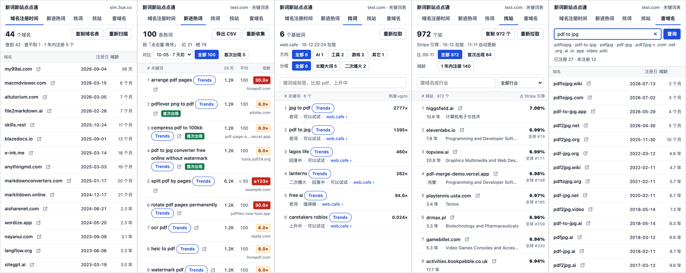

# 新词新站点点通（keyword-site-radar）

一个 Chrome 侧边栏插件，配一个本机小服务，用来在 [sim.3ue.co](https://sim.3ue.co)（Similarweb 镜像）上找**新出现的关键词**和**新上线的网站**：看当前页面上的域名哪天注册的，把关键词表里「流量远超体量」的词自动翻页收集出来，再和上一次查的结果比，看哪些是第一次出现。

*A Chrome side-panel extension (with a small local Python service) for SEO research on sim.3ue.co, a Similarweb mirror: sort the domains on a page by registration date, collect breakout keywords from keyword tables, browse seed keywords from web.cafe, list the sites that send traffic to Stripe checkout, and check which domain variants of a keyword are registered. The UI is in Chinese.*



<sub>从左到右：域名注册时间、新进热词、找词、找站、查域名（截图是测试页上的假数据）。</sub>

## 功能

| 页签 | 做什么 |
|---|---|
| **域名注册时间** | 收集当前 sim 页面上所有域名（链接地址和正文里像域名的文字），子域名归并到可注册域名，查注册日，**从新到旧**排列。和这一页上次扫描比：上次没有的标「首次出现」，在任何页面上都是第一次见到的标「从没见过」，上次有这次没有的折叠在底部。可以复制成表格。 |
| **新进热词** | 在 sim 的关键词表上，**按页面当前的排序**自动翻页，收集前 100 个 **KD = 0 且「28 天流量 ÷ 平均体量」> 5** 的词：> 20 红框，> 5 橙框，网页里的表格上也同时标框。每行有 Google Trends（和基准词 `gpts` 对比）、打开热门网址、热门网址所在的站。和上一次查询比，标出首次出现的词和消失的词。可以导出 CSV。 |
| **找词** | 从 [web.cafe 新词发现](https://new.web.cafe/keywords) 拉「长期大词」和「二次爆火」两组基础词（约 900 个），按方向（AI / 工具 / 游戏 / 其它）和分组筛选，可以搜词和标签，按热度（相对 `gpts` 的倍数）排。 |
| **找站** | sim 上 `checkout.stripe.com` 的「引荐网站」表（近 28 天、全球，约 970 个站）。能把访客送进 Stripe 结账页的站，就是在收钱的站。每个站显示域龄、行业、全球排名、引荐流量份额；可以按「1 年内注册」、行业、关键字筛选，和上一份比出首次出现的站，复制成表格。存满 30 天才自动重拉。 |
| **查域名** | 输入一个关键词，查它几种常见写法在 `.com .net .org .ai .io .app .video .wiki` 下的注册情况：完整域名、注册日、域龄，注册日从近到远排，没注册的放最后。 |

所有链接都在新标签页打开（按住 ⌘ 在后台打开）。点任何域名，打开的是 sim 上这个域名的「新进非品牌关键词」页，接着就可以在上面收集新进热词。

## 准备

- **Chrome**（桌面版）。
- **Python 3**：本机服务只用标准库，不用装依赖。
- **能登录 sim.3ue.co**：插件只在这个站上采集数据。「找词」还需要 new.web.cafe 的数据服务账号。
- 查注册日会直连各注册局的 RDAP 服务和 whois（43 端口）。
- 下面的开机自启用的是 macOS 的 launchd；别的系统直接运行 `python3 service/server.py` 也一样能用。

## 安装

**1. 下载代码**

```bash
git clone https://github.com/ppop123/keyword-site-radar.git
```

```bash
cd keyword-site-radar
```

**2. 启动本机服务**（监听 `127.0.0.1:8793`）

临时用，直接在前台运行：

```bash
python3 service/server.py
```

想开机自启（macOS），依次运行这三条：

```bash
mkdir -p var/logs
```

```bash
sed -e "s#/Users/wy/cafe/page-helper#$PWD#g" -e "s#/opt/homebrew/bin/python3#$(command -v python3)#" launchd/com.wy.page-helper.plist > ~/Library/LaunchAgents/com.wy.page-helper.plist
```

```bash
launchctl bootstrap gui/$(id -u) ~/Library/LaunchAgents/com.wy.page-helper.plist
```

以后重启服务用 `launchctl kickstart -k gui/$(id -u)/com.wy.page-helper`，卸载用 `launchctl bootout gui/$(id -u)/com.wy.page-helper`，再删掉 `~/Library/LaunchAgents/com.wy.page-helper.plist`。日志在 `var/logs/`。

**3. 加载插件**

Chrome 打开 `chrome://extensions`，打开右上角的「开发者模式」，点「加载已解压的扩展程序」，选项目里的 `extension/` 目录。把图标固定到工具栏，点图标就会打开侧边栏。

改了插件代码后，在 `chrome://extensions` 点这个插件的刷新按钮；已经打开的 sim 页面也要刷新一次。

## 使用

打开侧边栏时，会按当前页面自动选页签：在 sim 关键词表上选「新进热词」，在 sim 的其他页面选「域名注册时间」，不在 sim 上选「找词」。页签只负责切换视图，每个视图里有自己的按钮。

- **域名注册时间**：在任意 sim 页面（比如某个词的 SERP 市场参与者页）点「扫描本页域名」。3ue.co 和 similarweb.com 自身不算在内；`*.vercel.app` 这类托管子域单独列出，不查注册日。
- **新进热词**：打开某个域名的关键词表，先把表格排成想要的顺序，再点「收集前 100 条热词」。插件会在后台从第 1 页开始翻页，收满 100 条、翻完整张表或翻满 50 页就停（不够 100 条时可以「再翻 50 页」），然后回到你原来所在的那一页。收集过程中侧边栏要一直开着，也别手动去翻那张表。
  - 「名次」就是收集到的先后顺序，词在 sim 表里的位置放在悬停提示里。
  - 导出的 CSV 带 BOM，用 Excel 打开不会乱码。列依次是：框色、变化、名次、上次名次、表内名次、关键词、KD、28 天流量、平均体量、倍数、倍数是否为下限、热门网址。
- **和上次比**：每次扫描或收集完，都会给这张表存一份快照，同一张表同一天只留最后一份，每张表最多留 30 份。默认和今天之前最近的那一份比，下拉框里可以换成更早的。只有表格网址相同、排序也相同才能比。停止或出错的那一轮不存，也不比。
- **找词**：用的是你在 Chrome 里的 web.cafe 登录。拉一次要半分钟左右，之后 12 小时内直接用缓存；过期后在后台更新，更新期间照样显示手上这份。
- **找站**：如果已经有标签页开着那张引荐表，就直接读它（读完回到第 1 页）；没开的话会在后台开一个，读完关掉。共 10 页，约半分钟。域龄由本机服务查：已经查过的立刻显示，没查过的在后台慢慢补上。
- **查域名**：会按这几种写法组合：连写（`pdftojpg`）、连字符（`pdf-to-jpg`）、去掉 to / for / the 之类的虚词（`pdfjpg`、`pdf-jpg`）、to 写成 2（`pdf2jpg`）、for 写成 4。含中文的关键词不查。

## 注册日从哪来

先查 RDAP（按 IANA 引导表 `data.iana.org/rdap/dns.json` 找服务器），查不到再查 whois（先问 `whois.iana.org` 这个后缀用哪台 whois 服务器）。

- RDAP 不覆盖的后缀（如 .io、.me、.co、.de），靠 whois 补。
- 注册局不公开注册日的（如 .de），如实显示「查不到」，不拿「最后修改日」顶替，免得把老站当成新站。
- 结果缓存在 `var/cache.sqlite`：查到的注册日一直留着；查不到的 3 天后重查；超时、限流这类临时错误不缓存。查域名每次都重查，不用缓存里的「没有」。
- 子域名按[公共后缀表](https://publicsuffix.org/)（`data/public_suffix_list.dat`）归并：`tools.example.com` 算 `example.com`，所以子域显示的是主域名的年龄。
- 「未注册」只表示 RDAP 和 whois 都查不到注册记录。保留名、溢价名也会这样显示，买之前到注册商那里确认。

## 数据存在哪

- **本机服务**（`var/`，不进 git）：注册日缓存、每张表的快照、每个域名第一次被看到的时间。
- **插件**（Chrome 的 `chrome.storage.local`）：找词和找站拉到的数据。
- **项目里带的一份数据**（`extension/seed/`）：插件本地还没有数据时（比如第一次打开），找词和找站先用这份。它是 2026-10-12 拉取的：找词 923 个词，来自 web.cafe；找站 973 个站，来自 Similarweb（经 sim.3ue.co）。数据归原网站所有。想换成自己新拉的一份：先在插件里拉一次，再运行 `python3 tools/export-seed.py`，它会从 Chrome 里这个插件的存储导出到 `extension/seed/`。
- **网络请求**只发往这几处：sim.3ue.co 页面本身、new.web.cafe（找词）、IANA 和各注册局的 RDAP / whois（查注册日）。不向别处上传任何数据。
- **本机服务的访问限制**：只监听 `127.0.0.1`；POST 请求必须带 `X-Page-Helper: 1` 请求头；来自普通网页的请求一律返回 403。

## 局限

- 只能读到页面上已经渲染出来的内容。
- 新进热词只认表头为「关键词」「KD」「28 天流量」「平均体量」的表格，也就是 sim.3ue.co 的中文界面。界面换成英文或改版后，要改 `extension/hot.js` 里的表头匹配。
- 平均体量是「< 50」时只知道上限，所以倍数是下限，显示成「≥24.0×」。28 天流量是「< 50」的词一律不标。倍数正好等于 5 或 20 时不升档。
- 正文里的域名只认 ASCII（中文正文里域名常常紧贴着汉字）。链接里的中文域名，浏览器已经转成 punycode，照常能收到。
- 收集过程中关掉侧边栏，或者页面刷新、跳走，收集都会停下；已经收到的保留，可以接着收。
- 找站要求 sim 已经登录。如果后台开的页面没渲染出表格，就手动打开那张引荐表，开着的页面会被直接读取。

## 测试

测试页（`test/panel-harness*.html`）用假的 Chrome 接口和假的 sim、web.cafe 页面来驱动真实的侧边栏代码，其中「找站」会把真正的 `extension/ref.js` 注入到假的引荐页里跑。

```bash
npm install
```

```bash
npx playwright install chromium
```

```bash
npm test
```

`npm test` 运行 `test/refs-check.cjs`，共 29 个场景，覆盖找站的拉取、停止、重拉、标签页归属、30 天规则、域龄、查域名、项目自带数据等。`npm run frames -- <目录>` 会把各个视图截成亮色和暗色两套图，用来检查排版有没有坏。

## 目录

| 路径 | 内容 |
|---|---|
| `extension/` | 插件本体：`panel.*` 侧边栏，`hot.js` 注入关键词表，`ref.js` 注入 Stripe 引荐表，`sw.js` service worker，`seed/` 项目里带的数据 |
| `service/server.py` | 本机服务：域名归并（`/normalize`）、查注册日（`/lookup`）、快照（`/snapshot/*`） |
| `data/public_suffix_list.dat` | 公共后缀表 |
| `launchd/` | macOS 开机自启的配置模板 |
| `tools/export-seed.py` | 把插件已经拉到的数据导出成 `extension/seed/` |
| `test/` | 测试页、假接口、场景测试、截图脚本 |
| `design/` | 图标的生成脚本和素材、历次界面截图 |
| `docs/DEVLOG.md` | 开发记录：每次改动的决定、Codex 审查结果和验证数据 |

## 许可证

代码按 [MIT 许可证](LICENSE) 开源。`extension/seed/` 里的数据来自 web.cafe 和 Similarweb，不在 MIT 授权范围内，归原网站所有。
